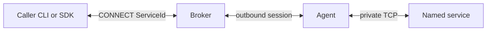

# Thirp Runtime

**Reach one named private service without opening the network around it.**

Thirp Runtime is an open-source data plane for connecting an authorized caller
to a service in a private environment. An Agent beside the private service
connects outbound to a Broker. A Caller asks for the service by logical name and
receives a bidirectional byte stream.

Thirp exposes the service—not the host, subnet, or customer network. It is not a
VPN, a general-purpose port forwarder, or an application hosting platform. The
Broker routes opaque streams by service identity; it does not interpret or
retain application payloads.



## Runtime and Cloud

Thirp Runtime and Thirp Cloud use the same data plane, but they solve different
operational problems.

| | Thirp Runtime | Thirp Cloud |
|---|---|---|
| What it is | Apache-2.0 Broker, Agent, Caller, CLI tools, Web Ingress, and embeddable SDK | Managed control plane and hosted Broker operation built on Thirp Runtime |
| Access control | Standalone Broker: static credentials and file-backed, deny-by-default policy | Managed identity, customer approval, timed grants, revocation, audit, and usage |
| Operating model | Self-hosted | Thirp-hosted |
| Availability | Linux operator archive, cross-platform data-plane archives and source | Managed service |

The customer-side process used with Thirp Cloud is the same open-source
`thirp-agent` provided by Runtime. Runtime does not require Thirp Cloud.

Learn about Thirp Cloud at [thirp.net](https://thirp.net/).

## Project status

Thirp Runtime 0.16.16 uses wire protocol 1.0. [Wire specification](docs/PROTOCOL.md)

The Linux operator bundle includes Broker, Agent, Caller and Web Ingress.
The macOS arm64, macOS Intel and Windows AMD64 data-plane bundles include
Agent, Caller and the C shared library. See the platform builds and downloads.
[Building](docs/BUILDING.md#release-archives)

## What is included

| Component | Purpose |
|---|---|
| [`thirp-broker`](broker_cli/README.md) | Authenticates peers, authorizes named-service operations, and relays streams |
| [`thirp-agent`](agent_cli/README.md) | Connects outbound, registers one or more services, and relays to private TCP targets |
| [`thirp-connect`](caller_cli/README.md) | Exposes an authorized service on a loopback port for existing tools |
| [`thirp-web-ingress`](web_ingress_cli/README.md) | Makes an explicitly routed HTTP/HTTPS service reachable by an unmodified browser |
| [Odin and C SDKs](docs/SDK.md) | Embed Agent or Caller behavior directly in an application |

`thirp-echo` and `thirp-echo-http` are local test fixtures, not installed
products.

For an enrolled caller, run `thirp-connect --caller-conf /path/to/caller.conf`.
One process serves every service/listen link in that file and maintains its
credentials. See [caller enrollment usage](caller_cli/README.md#caller-enrollment).

## Try it locally

The supported local walkthrough uses TLS and exercises the complete path:

```text
curl → thirp-connect → thirp-broker ← thirp-agent → private HTTP service
```

Start the Broker, Agent and Caller with a loopback certificate, then send an
HTTP request through the relay. The guide covers Linux, macOS and Windows.

**Start here: [Local TLS quickstart](docs/QUICKSTART.md).**

## How authorization works

A successful connection requires three separate facts:

1. An authenticated Agent owns the requested `ServiceId`.
2. An authenticated Caller has permission to connect to that exact service or
   an explicitly granted namespace.
3. The Agent can reach the configured local target.

Production policy is deny-by-default. The Agent role can register services
and the Caller role can connect to them. The authenticated principal also
needs the corresponding capability and grant.

Runtime policy is intentionally local and file-backed. A replaceable Broker
authenticator and authorizer allow a managed control plane—such as Thirp
Cloud—to supply dynamic identity, approval, grant, and revocation decisions
without changing protocol 1.0.

See the [production walkthrough](docs/OPERATIONS.md#production-walkthrough) for
separate least-privilege credentials and exact service grants.

## Operations

See the operations guide for configuration, TLS, recovery, metrics and
deployment. [Operations](docs/OPERATIONS.md)

## Embed Runtime

Applications can host and dial services without spawning the command-line
tools:

- Odin applications import `thirp:agent` and `thirp:caller` (all platforms).
- C applications link the shared library `libthirp.so` (Linux), `libthirp.dylib`
  (macOS), or `libthirp.dll` (Windows) through `thirp.h`.
- Hosted Broker implementations can consume the Broker Odin collection and
  provide their own authenticator and authorizer.
- Ephemeral hosting can generate a short join code for use cases such as
  peer-hosted games. A join code identifies a service; it is not a credential.

The supported API surface, lifecycle, examples, artifact layouts, and C link
instructions are in [docs/SDK.md](docs/SDK.md).

## Documentation

| If you want to… | Read |
|---|---|
| Run the local TLS relay | [Quickstart](docs/QUICKSTART.md) |
| Build, test, or package Runtime | [Building](docs/BUILDING.md) |
| Deploy a self-hosted Broker and Agents | [Operations](docs/OPERATIONS.md) |
| Embed Agent or Caller behavior | [SDK](docs/SDK.md) |
| Evaluate security boundaries and residual risk | [Security](docs/SECURITY.md) |
| Understand wire behavior | [Protocol](docs/PROTOCOL.md) |
| Check protocol, config, SDK, or C ABI compatibility | [Compatibility](docs/COMPATIBILITY.md) |
| Review user-visible changes | [Changelog](docs/CHANGELOG.md) |
| Configure a specific command | [Broker](broker_cli/README.md), [Agent](agent_cli/README.md), [Connect](caller_cli/README.md), or [Web Ingress](web_ingress_cli/README.md) |

Additional project references:

- [Dependencies](docs/DEPENDENCIES.md)
- [Odin naming conventions](docs/NAMING.md)
- [Trademark notice](docs/TRADEMARKS.md)

## Security

Report vulnerabilities to `security@thirp.net`. Do not open a public issue for
an unfixed vulnerability. See [docs/SECURITY.md](docs/SECURITY.md) for the
self-hosted threat model and release-signing key.

## License

Apache-2.0. See [LICENSE](LICENSE) and [NOTICE](NOTICE).
